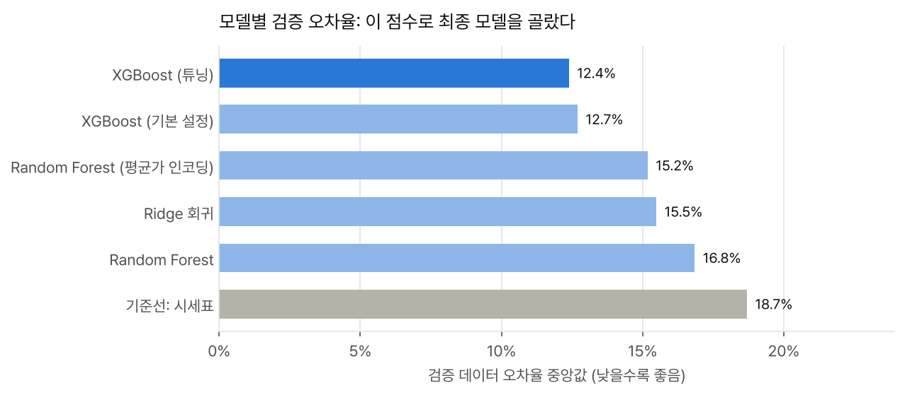
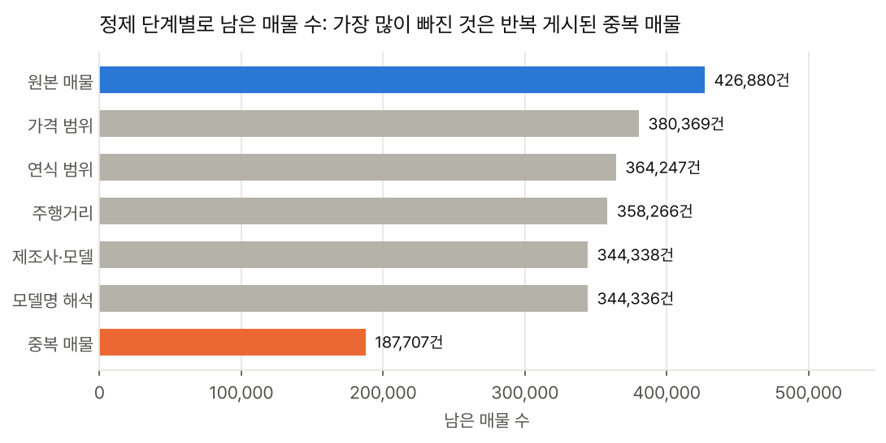
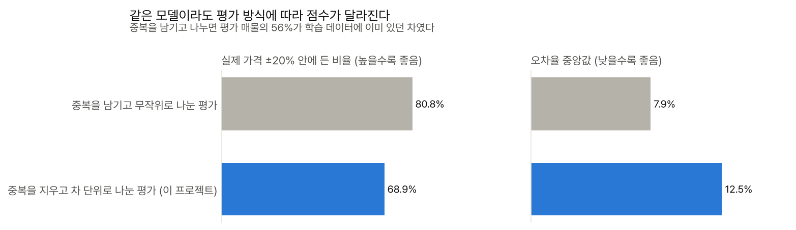
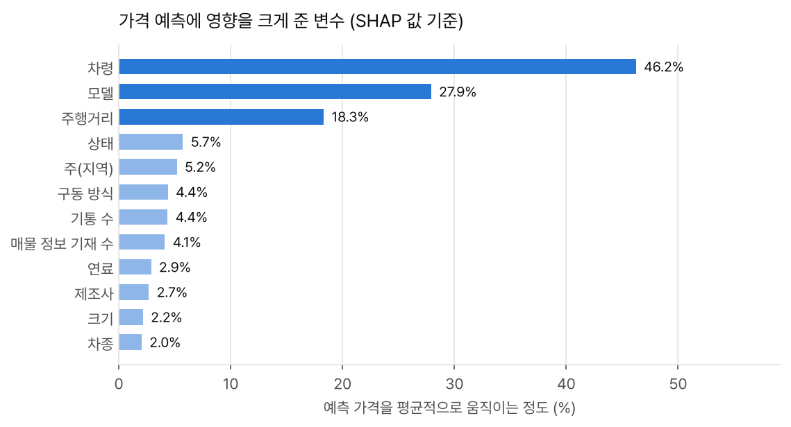
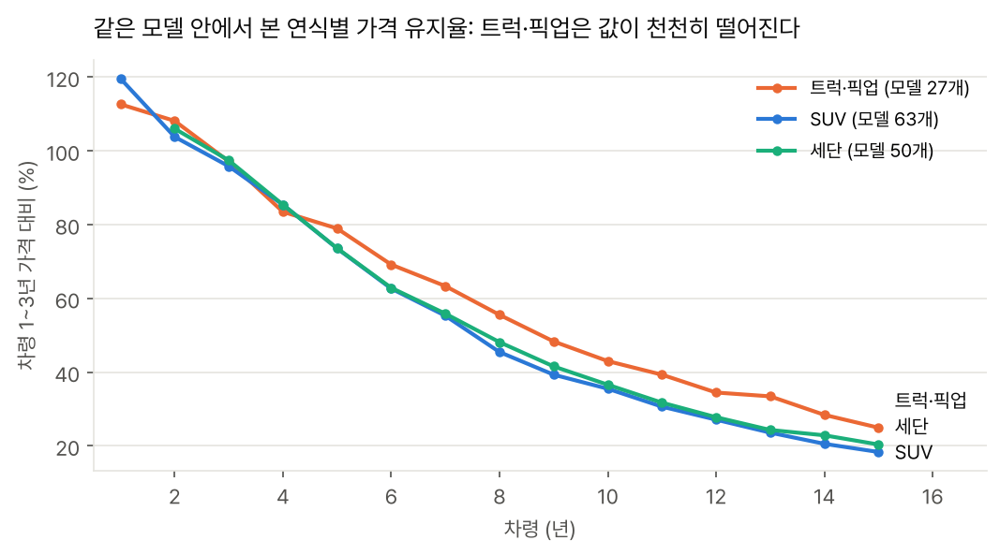

# 중고차 시세 예측 모델

실제 중고차 매물 426,880건을 정제해 **187,707대의 차로 시세 예측 모델**을 만들고, 점수가 부풀려지지 않는 평가 방식으로 시세표·선형 모델·Random Forest·XGBoost를 비교했습니다. 모든 실험은 **MLflow**에 기록했고, 예측 시세와 80% 시세 구간, 가격을 움직인 요인을 돌려주는 **FastAPI** 서비스로 마무리했습니다.

> **[시세 직접 계산해 보기](https://sung-ju-park.github.io/projects/used-vehicle-price-demo/)** · **[분석 리포트 보기](https://sung-ju-park.github.io/projects/used-vehicle-price-report.html)** · [프로젝트 소개](https://sung-ju-park.github.io/projects/used-vehicle-price.html)



## 한눈에 보기

| | |
|---|---|
| **문제** | 판매자가 입력한 매물 정보만으로 중고차 시세를 예측하고, 시세 범위와 근거까지 보여주기 |
| **데이터** | Craigslist 미국 중고차 매물 426,880건 (Kaggle 공개 데이터, 2021년 수집) → 정제 후 187,707대, 트럭·픽업 15% |
| **방법** | 정제 파이프라인, 중복 매물 제거와 누수 없는 평가 설계, 시세표 기준선, Ridge·Random Forest·XGBoost 비교, Optuna 튜닝, SHAP 해석, 분위수 회귀 + CQR 예측 구간 |
| **도구** | Python, pandas, scikit-learn, XGBoost, Optuna, **MLflow**(실험 기록·모델 레지스트리), FastAPI, pytest |
| **결과** (평가 데이터) | 오차율 중앙값 **18.7% → 12.4%** (시세표 대비), 실제 가격 ±20% 적중 **69.6%**, 80% 시세 구간 포함률 **80.3%** |

## 평가 설계

중복을 지운 187,707대를 차 단위로 다섯 묶음으로 나눴습니다.

| 묶음 | 대수 | 쓰임 |
|---|---|---|
| 학습 | 103,241 | 모델 학습 |
| 조기 종료 | 9,385 | XGBoost 나무 수 결정 |
| 검증 | 18,770 | 모델 비교·선택, Optuna 튜닝, 트럭 전용 모델 필요 여부 판단 |
| 보정 | 18,770 | 80% 시세 구간 보정(CQR) |
| 평가 | 37,541 | 최종 모델 성능 측정 (모델 선택이 끝난 뒤) |

- 모든 후보 모델은 검증 데이터로 비교했고, 검증 오차율이 가장 낮은 모델을 코드에서 자동으로 최종 모델로 고릅니다.
- 평가 데이터로는 최종 모델을 채점하고, 비교 참고용으로 시세표 기준선을 함께 쟀습니다. 시세표 점수는 선택에 쓰지 않았습니다.
- 조기 종료용 데이터를 검증용과 따로 둔 것은, 나무 수를 정한 데이터로 다시 채점하면 XGBoost만 검증 점수가 유리해지기 때문입니다.

## 핵심 결과

**1. 원본 매물의 44%는 같은 차를 반복 게시한 것이었다**
VIN이 있는 매물 265,838건 중 실제 차는 118,246대였고, 한 대가 최대 261번 올라왔습니다. 반복 게시된 차의 67%는 여러 지역에, 91%는 같은 가격으로 올라왔습니다. 딜러가 같은 차를 여러 지역에 올린 것입니다.



**2. 중복을 그대로 두고 평가하면 점수가 부풀려진다**
같은 XGBoost 설정과 절차로, 중복을 남긴 채 매물 단위로 무작위로 나누면 평가 매물의 **56%가 학습 데이터에 이미 있던 차**였고 ±20% 적중률이 80.8%로 나왔습니다. 중복을 지우고 차 단위로 나눈 정직한 평가에서는 68.9%입니다. 이 프로젝트의 모든 수치는 뒤의 방식으로 쟀습니다. 이 점검은 최종 평가 데이터에 속한 차를 빼고 나머지 데이터로만 했습니다.



**3. XGBoost가 시세표보다 오차를 34% 줄였다**

검증 데이터로 비교한 결과입니다. 이 점수로 최종 모델을 골랐습니다.

| 모델 (검증 데이터) | 오차율 중앙값 | ±20% 적중 | 평균 절대 오차 | 학습 시간 |
|---|---|---|---|---|
| **XGBoost (튜닝)** | 12.4% | 69.5% | $2,454 | 50초 |
| XGBoost (기본 설정) | 12.7% | 69.3% | $2,476 | 19초 |
| Random Forest (평균가 인코딩) | 15.2% | 61.5% | $2,993 | 25초 |
| Ridge 회귀 | 15.5% | 61.0% | $3,242 | 2초 |
| Random Forest | 16.8% | 57.0% | $3,280 | 23초 |
| 기준선: 시세표 | 18.7% | 52.5% | $3,808 | 0초 |
| 기준선: 전체 중앙값 | 53.1% | 16.1% | $9,157 | 0초 |

Optuna 튜닝으로 줄어든 검증 오차율은 0.3%p로 작았습니다. 큰 차이는 튜닝보다 데이터 정제와 모델 종류에서 나왔습니다.

최종 모델로 고른 **XGBoost (튜닝)**을 평가 데이터 37,541대로 한 번 채점한 결과는 오차율 중앙값 **12.4%**, ±20% 적중 **69.6%**, 평균 절대 오차 **$2,457**입니다. 검증 점수(12.4%)와 비슷해 검증 데이터에 과하게 맞춘 흔적은 보이지 않았습니다. 같은 평가 데이터에서 시세표 기준선은 18.7%였습니다.

**4. 가격을 가장 크게 움직인 것은 차령, 모델, 주행거리**



**5. 트럭·픽업은 시세표로는 오차가 컸지만, 모델이 차종 가운데 가장 큰 폭으로 줄였다**

| 차종 | 평가 매물 | 시세표 오차율 | 모델 오차율 | 80% 구간 포함률 |
|---|---|---|---|---|
| 트럭·픽업 | 5,539 | 20.4% | 12.6% | 79.9% |
| SUV | 7,973 | 15.6% | 10.8% | 80.4% |
| 세단 | 8,438 | 17.2% | 11.6% | 81.1% |
| 기타 차종 | 6,773 | 19.8% | 12.4% | 80.1% |
| 차종 미기재 | 8,818 | 21.4% | 15.0% | 79.6% |

위 표는 평가 데이터 기준입니다. 트럭 전용 모델이 필요한지는 검증 데이터의 트럭 2,738대로 판단했습니다. 트럭만으로 학습한 모델의 오차율은 12.85%, 전체로 학습한 모델은 12.49%였습니다. 전체 데이터로 학습한 모델이 더 나았습니다. 다른 차종에서 배운 감가 패턴이 트럭에도 도움이 되는 것으로 보여, 하나의 모델로 운영하기로 했습니다. 같은 모델 안에서 비교하면 트럭·픽업은 10년차에 1~3년차 가격의 43%를 유지해 세단(37%), SUV(35%)보다 값이 천천히 떨어졌습니다.



**6. 80% 시세 구간을 보정해 실제로 80%를 담게 했다**
분위수 회귀만으로는 실제 가격이 구간에 든 비율이 75.1%였습니다. 보정용 데이터로 CQR(Conformalized Quantile Regression)을 적용해 80.3%로 맞췄고, 차종별로도 79.6~81.1%를 유지했습니다.

**7. 시세와 크게 다른 매물은 대부분 매물 정보의 문제로 보인다**
평가 매물 중 실제 가격이 예측의 0.4배 미만인 매물이 492건, 2.5배를 넘는 매물이 138건이었습니다. 1,000달러를 살짝 넘긴 2020년식 에스컬레이드(선납금이나 계약금으로 보임), 111,111달러·123,456달러 같은 자리표시 가격이 대표적입니다. 규칙만으로 걸러지지 않는 이상 가격을 모델이 검수 대상으로 짚어낼 수 있습니다.

## 분석 과정에서 내린 판단

| 상황 | 판단 |
|---|---|
| 원본 매물의 44%가 같은 차의 반복 게시였다 | VIN으로 같은 차를 묶고 최신 게시물 하나만 남겼다. VIN이 없으면 제조사·모델·연식·주행거리가 같으면 같은 차로 봤다 |
| VIN 없는 반복 게시 묶음 중, 1,000 단위로 떨어지는 주행거리는 가격까지 같은 비율이 53%뿐이었다 (끝자리 있는 주행거리는 89%) | 100,000마일처럼 둥근 주행거리는 서로 다른 차가 겹친 것으로 보고, 이때는 가격까지 같아야 같은 차로 판정했다 |
| 중복을 남기고 무작위로 나누면 ±20% 적중률이 80.8%로 나왔다 | 평가 매물의 56%가 학습 데이터에 있던 차였다. 중복 제거 후 차 단위로 나눠 처음 보는 차에 대한 성능만 보고했다 |
| Random Forest가 선형 모델보다 못했다 (16.8% 대 15.5%) | 378개 모델을 정수 코드로 넣어 모델 정보를 거의 못 쓰고 있었다. 모델·제조사·주의 평균 가격으로 바꿔 넣는 타깃 인코딩(5겹 교차 방식)으로 15.2%까지 개선했다 |
| 튜닝 효과가 작았다 (검증 12.7% → 12.4%) | 튜닝보다 정제와 평가 설계가 결과를 더 크게 좌우했다고 판단했다 |
| 모델 비교에 평가 데이터를 쓰면 선택 자체가 평가 데이터에 맞춰진다 | 비교·튜닝·운영 판단은 검증 데이터로 하고, 평가 데이터는 최종 모델을 고른 뒤 성능을 재는 데만 썼다 |
| 80% 구간이 실제로는 75.1%만 담았다 | 분위수 회귀를 그대로 쓰지 않고 CQR로 보정해 80.3%로 맞췄다 |
| 트럭 전용 모델이 필요한가 | 전체 모델이 트럭도 더 잘 맞혀, 하나의 모델로 운영하기로 했다 (검증 데이터 기준) |

## 시세 예측 API

모델 파일(`models/*.ubj`, `models/meta.json`)은 용량 때문에 저장소에 올리지 않았습니다. 아래 재현 방법대로 `run_all.py`를 한 번 실행하면 만들어지고, 그 뒤에 API를 띄울 수 있습니다.

```bash
uvicorn serve.app:app --reload
```

```
POST /predict
{"year": 2016, "manufacturer": "ford", "model": "F-150 XLT", "odometer": 98000, "type": "pickup", "drive": "4wd", "state": "tx"}

→ {"estimate_usd": 30030, "range_80_usd": [24570, 38260], "model_key": "ford f-150",
    "top_factors": [{"feature": "차령", "effect_pct": 50.1}, {"feature": "모델", "effect_pct": 39.3}, …]}
```

예측 시세(`estimate_usd`), 80% 시세 구간(`range_80_usd`), 가격을 가장 크게 움직인 요인 4개(`top_factors`, SHAP 값 기준)를 돌려줍니다. 처음 보는 모델명은 제조사별 '기타'로 처리하고, 범위를 벗어난 입력은 거부합니다. 학습 데이터에 주(state)가 빠진 매물이 없어 주는 필수로 받습니다.

## 데이터 파이프라인 (SQL)

정제 결과를 SQLite 데이터베이스에 단계별 테이블로 저장하고, 품질 검사와 주요 숫자 재계산을 SQL로 합니다 (`python src/build_db.py`).

| 테이블 | 행 수 | 내용 |
|---|---|---|
| `raw_listings` | 426,880 | 원본 매물 그대로 |
| `clean_listings` | 344,336 | 정제 규칙을 통과한 매물 + 같은 차를 묶는 키 (중복 포함) |
| `vehicles` | 187,707 | 같은 차는 최신 게시물 하나만, 데이터 묶음(split) 표시 |
| `training_data` (뷰) | 187,707 | 학습·평가에 쓰는 데이터 |

- 스키마는 `sql/schema.sql`, 검사는 `sql/quality_checks.sql`, 재계산은 `sql/reports.sql`에 있습니다. 정제 기준값은 `src/config.py`에서 SQL 파라미터로 넘겨, 기준이 두 군데서 따로 놀지 않게 했습니다.
- 정제 단계별 건수, VIN 반복 게시 통계, 트럭 비율 등 **15개 숫자를 SQL로 다시 계산해 pandas 결과와 15개 모두 일치**하는 것을 확인했고, `training_data` 뷰가 실제 학습에 쓴 데이터·분리와 같은지도 확인합니다.
- 오류 단계 검사가 하나라도 걸리면 실행이 실패합니다. 경고 단계는 건수만 기록합니다.

| 검사 | 단계 | 내용 | 건수 |
|---|---|---|---|
| `price_range` | 오류 | 학습 데이터에 가격 범위(1,000~150,000달러) 밖 매물이 있다 | 0 |
| `year_range` | 오류 | 학습 데이터에 연식 범위(1995~2022) 밖 매물이 있다 | 0 |
| `odometer_rule` | 오류 | 주행거리가 비었거나 범위 밖이거나, 2년 넘은 차인데 100마일 미만(자리표시)이다 | 0 |
| `required_fields` | 오류 | 제조사·모델명·주(state)·기본 모델명 중 비어 있는 값이 있다 | 0 |
| `clean_follows_rules` | 오류 | 정제 테이블(clean_listings)에 정제 규칙을 어긴 매물이 남아 있다 | 0 |
| `latest_posting_kept` | 오류 | 같은 차의 게시물 중 가장 최근 것(ID가 가장 큰 것)을 남기지 않은 차가 있다 | 0 |
| `postings_count` | 오류 | 차량별 게시 횟수(n_postings)가 정제 테이블의 실제 게시물 수와 다르다 | 0 |
| `every_vehicle_kept` | 오류 | 정제 테이블에는 있는데 차량 테이블에서 빠진 차가 있다 | 0 |
| `vin_split_leak` | 오류 | 올바른 VIN이 같은 차가 서로 다른 데이터 묶음(학습·검증·평가 등)에 함께 들어가 있다 | 0 |
| `split_share` | 오류 | 데이터 묶음 비율이 설정(학습 55·조기 종료 5·검증 10·보정 10·평가 20%)과 0.1%p 넘게 다르다 | 0 |
| `invalid_vin_across_splits` | 경고 | 형식이 틀린 17자리 VIN(I·O·Q 포함)이 여러 묶음에 나뉘어 있다. 광고 문구를 VIN 칸에 쓴 다른 차들이거나, 0을 O로 잘못 적은 같은 차일 수 있다 | 2 |
| `possible_residual_duplicate` | 경고 | 평가 데이터의 차 중, 제조사·모델·연식·주행거리·가격이 모두 같은 차가 다른 묶음에도 있다 (한쪽만 VIN을 적은 같은 차일 수 있음) | 141 |
| `placeholder_price` | 경고 | 111,111달러·123,456달러처럼 자리표시로 보이는 가격이 학습 데이터에 남아 있다 | 174 |

처음 만든 VIN 누수 검사는 2건을 잡았는데, 확인해 보니 'AFFORDABLEQUALITY'처럼 광고 문구를 VIN 칸에 적은 서로 다른 차들과, 숫자 0을 알파벳 O로 잘못 적은 VIN이었습니다. 둘 다 정제 단계에서 '올바르지 않은 VIN'으로 보고 VIN 대신 제조사·모델·연식·주행거리로 묶었기 때문에 생긴 일이라, 오류 검사는 올바른 VIN 기준으로 하고 이런 경우는 경고로 따로 셉니다. 제조사·모델·연식·주행거리·가격이 모두 같은 '중복 의심' 차는 평가 데이터의 0.4%(141대)라 결과에 미치는 영향은 작지만, 실제 서비스라면 VIN 오타 보정(O→0 등)을 정제 규칙에 넣을 만합니다.

## 시세 체험 페이지

**[https://sung-ju-park.github.io/projects/used-vehicle-price-demo/](https://sung-ju-park.github.io/projects/used-vehicle-price-demo/)**

차 정보를 넣으면 브라우저 안에서 예상 시세, 80% 시세 구간, 가격을 움직인 요인, 주행거리·연식에 따른 시세 곡선을 바로 계산합니다. 서버 없이 `demo/model.json`(gzip 약 1MB)만 읽어서 나무를 따라 내려가는 방식이라 GitHub Pages에서 그대로 돌아갑니다.

- 본 모델(약 60MB)은 웹에 올리기 무거워서, 같은 데이터·같은 분리로 깊이 6, 나무 300개 이하의 경량 모델을 따로 학습했습니다(`src/export_demo.py`).
- 경량 모델에는 **차령·주행거리 단조 제약**을 걸었습니다. 제약 없이 학습하면 '정확히 100,000마일'처럼 어림값으로 적은 매물의 굴곡까지 따라가서 "더 많이 탔는데 더 비싸다"는 결과가 나왔습니다. 검증 오차율이 0.6%p 나빠지는 대신 결과가 직관적입니다.
- 판매자에게 오해를 줄 수 있는 '매물 정보 기재 수'와, 단조 제약과 충돌하는 '연평균 주행거리'는 경량 모델에서 뺐습니다.
- 평가 데이터 기준 경량 모델 오차율 중앙값 13.3%, ±20% 적중 67.0%, 80% 구간 포함률 80.2% (본 모델 12.4%).
- 내보낸 나무로 계산한 값이 XGBoost 예측과 같은지 내보낼 때 한 번, 브라우저 계산기(`demo/predict.js`)가 같은 값을 내는지 `pytest`(node 사용)에서 한 번 검산합니다 (최대 차이 0.0001 미만, log 가격).

## 구조

```
used-vehicle-price-model/
├─ src/
│  ├─ run_all.py          # 전체 실행
│  ├─ clean.py            # 정제 규칙, 모델명 정규화, 중복 판정
│  ├─ features.py         # 입력 변수 (차령, 주행거리, 연평균 주행거리, 적재 등급 등)
│  ├─ split.py            # 학습·조기 종료·검증·보정·평가 분리
│  ├─ baselines.py        # 전체 중앙값, 시세표 기준선
│  ├─ models.py           # Ridge, Random Forest(정수 코드·타깃 인코딩), XGBoost
│  ├─ train.py            # 검증 데이터로 모델 비교·튜닝·선택, 최종 평가, 평가 방식 점검 (모두 MLflow 기록)
│  ├─ intervals.py        # 분위수 회귀 + CQR 보정
│  ├─ analyze.py          # 차종·가격대·연식별 오차, SHAP, 가격 유지율, 이상 매물
│  ├─ build_db.py         # SQLite 저장, SQL 품질 검사·재계산
│  ├─ export_demo.py      # 체험 페이지용 경량 모델 학습·검산·JSON 내보내기
│  ├─ figures.py, report.py, make_readme.py
│  └─ mlflow_screenshot.py
├─ serve/app.py           # FastAPI 시세 예측 API
├─ sql/                   # 스키마, 품질 검사, 재계산 쿼리
├─ demo/                  # 시세 체험 페이지 (index.html, predict.js, model.json)
├─ tests/                 # 정제 규칙·API·SQL 품질 검사·체험 페이지 계산기 테스트 (pytest)
├─ outputs/               # 리포트, 그래프, results.json
├─ Dockerfile             # API 컨테이너
└─ data/raw/              # 원본 데이터 (저장소에는 포함하지 않음)
```

## 재현 방법

```bash
pip install -r requirements.txt
# data/raw/vehicles.csv 준비 (data/raw/README.md 참고)
python src/run_all.py          # 정제 → 실험(MLflow 기록) → 분석 → 리포트 → 모델 파일 저장, 2코어 기준 약 30분
mlflow ui --backend-store-uri sqlite:///mlflow.db   # 실험 기록 보기
python src/build_db.py         # SQLite 저장과 SQL 품질 검사만 다시 (run_all.py에 포함)
python src/export_demo.py      # 체험 페이지용 경량 모델 (demo/model.json)
pytest -q                      # 테스트
```

## 한계

- 판매자가 부른 **매물 가격**이라 실제 거래 가격과 다를 수 있습니다.
- 승용차 중심 데이터이고 트럭·픽업은 15%입니다. **상용 트럭 전용 데이터가 아니므로**, 트럭 분석은 픽업 위주의 하위 집단 분석입니다.
- 데이터가 2021년 한두 달치라 **시간에 따른 시세 변화**는 보지 못했습니다. 실제 서비스라면 과거로 학습해 이후 기간으로 평가하고, 성능을 주기적으로 감시해 재학습 시점을 정해야 합니다.
- 화물차 시세에 중요한 **적재 중량, 차축, 적재함 형태, 정비 이력**은 데이터에 없어 모델명에서 적재 등급만 뽑았습니다.
- **미국 데이터**라 국내 시장에 쓰려면 같은 정제·평가 방식으로 국내 매물 데이터에 다시 학습해야 합니다.
- MLflow는 실험 기록과 모델 등록에 썼습니다. API는 로컬에서 동작을 확인했으며, 클라우드 배포나 운영 중 성능 모니터링은 하지 않았습니다.

## 데이터

Austin Reese, *Used Cars Dataset* (Craigslist 미국 중고차 매물, Kaggle). 원본 데이터는 저장소에 포함하지 않았습니다.
